Appearances in T.V, Radio, Podcasts and other media, This section is not including the [lectures](/lectures/) that were recorded or broadcast.

<nav aria-label="Jump to section" class="years">

[Sample highlights](#highlights) [Sample keynotes and talks](#keynotes) [Sample interviews and webinars](#interviews) [APC HardTalks and round tables](#apc) [ETPPA interviews](#etppa) [The Payments Trilogue](#tpt) [Short clips](#clips) [Further press, radio, TV and podcasts](#press)

</nav>

<h2 id="highlights">Sample highlights</h2>

<figure>
<a href="https://www.youtube.com/watch?v=AE0BXH5KdOM" data-yt="AE0BXH5KdOM" title="European Parliament hearing, March 2016">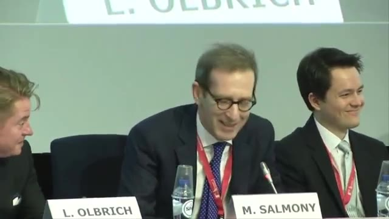Play: European Parliament hearing, March 2016Plays from YouTube</a>
<figcaption>European Parliament hearing, March 2016 (52 min)</figcaption></figure>
<figure>
<a href="https://www.youtube.com/watch?v=bh9RFnCpVNE" data-yt="bh9RFnCpVNE" title="Salmony at ECB Conference 2017">Play: Salmony at ECB Conference 2017Plays from YouTube</a>
<figcaption>Salmony at ECB Conference 2017 (21 min)</figcaption></figure>
<figure><video class="video-own" controls preload="none" poster="/assets/video/portrait-michael-salmony.jpg" width="1280" height="720"><source src="/assets/video/portrait-michael-salmony.mp4" type="video/mp4"></video><figcaption>Portrait of Michael Salmony, Equens, 2014 (4 min)</figcaption></figure>
<figure>
<a href="https://www.youtube.com/watch?v=_-38Q_FAN0Q" data-yt="_-38Q_FAN0Q" title="Intro to “The End of Money” at New Scientist Live, London, October 2019">Play: Intro to “The End of Money” at New Scientist Live, London, October 2019Plays from YouTube</a>
<figcaption>Intro to “The End of Money” at New Scientist Live, London, October 2019 (1 min)</figcaption></figure>
<figure>
<a href="https://www.youtube.com/watch?v=_DoOGix1m94" data-yt="_DoOGix1m94" title="Fireside chat on Open Banking, Mastercard LAC (Latin America and Caribbean) Innovation Forum RISE, Florida, 2021">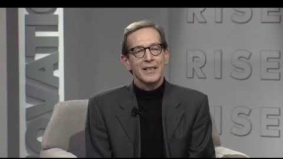Play: Fireside chat on Open Banking, Mastercard LAC (Latin America and Caribbean) Innovation Forum RISE, Florida, 2021Plays from YouTube</a>
<figcaption>Fireside chat on Open Banking, Mastercard LAC (Latin America and Caribbean) Innovation Forum RISE, Florida, 2021 (19 min)</figcaption></figure>
<figure>
<a href="https://www.youtube.com/watch?v=CvpcvQlUF6s" data-yt="CvpcvQlUF6s" title="Technology panel at the EPC 20th Anniversary event, June 2022">Play: Technology panel at the EPC 20th Anniversary event, June 2022Plays from YouTube</a>
<figcaption>Technology panel at the EPC 20th Anniversary event, June 2022 (21 min)</figcaption></figure>
<figure id="istanbul-b2b-keynote">
<a href="https://www.youtube.com/watch?v=6XFpVBKw7Mc" data-yt="6XFpVBKw7Mc" title="Keynote at the FinTech Istanbul B2B Connect Summit, October 2023">Play: Keynote at the FinTech Istanbul B2B Connect Summit, October 2023Plays from YouTube</a>
<figcaption>Keynote at the FinTech Istanbul B2B Connect Summit, October 2023 (16 min)</figcaption></figure>

<h2 id="keynotes">Sample keynotes and talks</h2>

<figure>
<a href="https://www.youtube.com/watch?v=OXW94WJ3RbM" data-yt="OXW94WJ3RbM" title="Closing speech on CBDC and Digital Currencies, Payments Nordics, June 2022">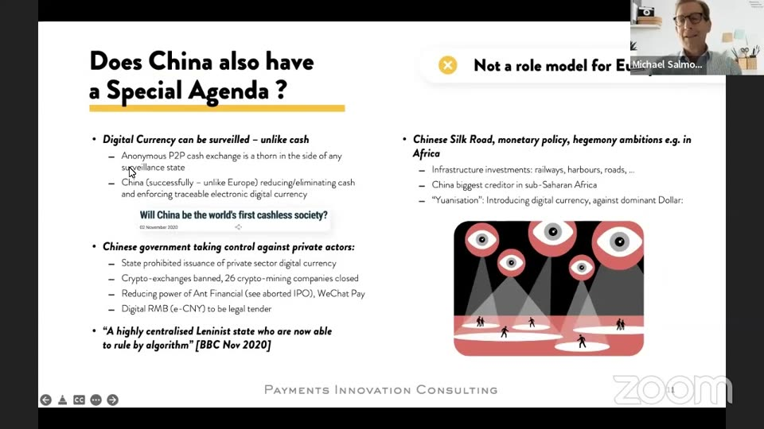Play: Closing speech on CBDC and Digital Currencies, Payments Nordics, June 2022Plays from YouTube</a>
<figcaption>Closing speech on CBDC and Digital Currencies, Payments Nordics, June 2022 (45 min)</figcaption></figure>
<figure>
<a href="https://www.youtube.com/watch?v=iVl8K5Wfz-A" data-yt="iVl8K5Wfz-A" title="“CBDC - will the mouton à cinq pattes fly?”, BizzPay 9.0 Payments Forum, The Hague, May 2021">Play: “CBDC - will the mouton à cinq pattes fly?”, BizzPay 9.0 Payments Forum, The Hague, May 2021Plays from YouTube</a>
<figcaption>“CBDC - will the mouton à cinq pattes fly?”, BizzPay 9.0 Payments Forum, The Hague, May 2021 (36 min)</figcaption></figure>

<h2 id="interviews">Sample interviews and webinars</h2>

<figure>
<a href="https://www.youtube.com/watch?v=fAfjzIb-D_M" data-yt="fAfjzIb-D_M" title="Interview at Saïd Business School, University of Oxford, on Open Banking, Open Finance and AI, 2024">Play: Interview at Saïd Business School, University of Oxford, on Open Banking, Open Finance and AI, 2024Plays from YouTube</a>
<figcaption>Interview at Saïd Business School, University of Oxford, on Open Banking, Open Finance and AI, 2024 (5 min)</figcaption></figure>
<figure>
<a href="https://www.youtube.com/watch?v=WLu5VbCPvws" data-yt="WLu5VbCPvws" title="“Open Banking for B2B: Maximising data for corporates”, Finextra webinar with Isabel/Ponto and BNY Mellon, December 2023">Play: “Open Banking for B2B: Maximising data for corporates”, Finextra webinar with Isabel/Ponto and BNY Mellon, December 2023Plays from YouTube</a>
<figcaption>“Open Banking for B2B: Maximising data for corporates”, Finextra webinar with Isabel/Ponto and BNY Mellon, December 2023 (62 min)</figcaption></figure>
<figure>
<a href="https://www.youtube.com/watch?v=JnrXUnwEBSY" data-yt="JnrXUnwEBSY" title="The European data market - regulation and incentives, interview for OpenX, 2022">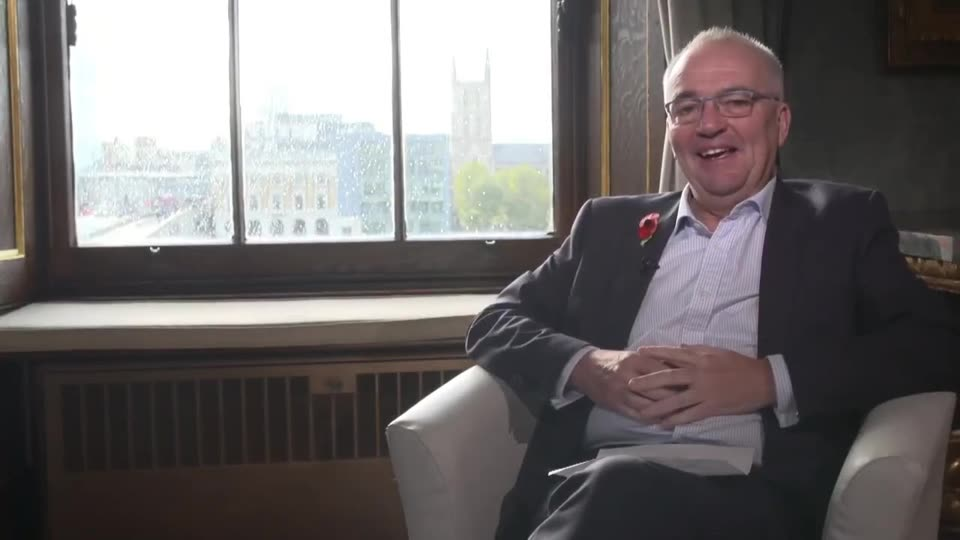Play: The European data market - regulation and incentives, interview for OpenX, 2022Plays from YouTube</a>
<figcaption>The European data market - regulation and incentives, interview for OpenX, 2022 (6 min)</figcaption></figure>
<figure>
<a href="https://www.youtube.com/watch?v=SWXjFIKI7sk" data-yt="SWXjFIKI7sk" title="Open Banking in mainland Europe, Oxford AI in Fintech and Open Banking Programme, August 2021">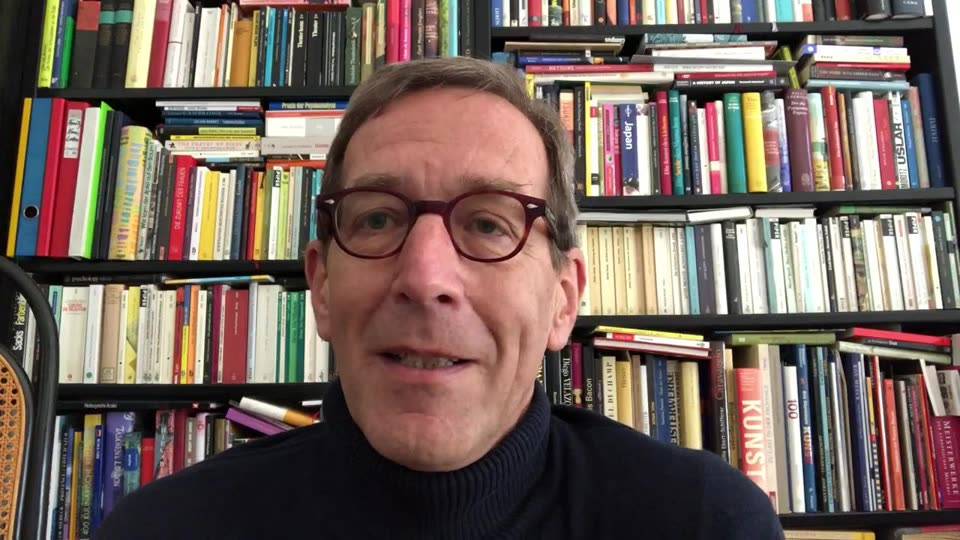Play: Open Banking in mainland Europe, Oxford AI in Fintech and Open Banking Programme, August 2021Plays from YouTube</a>
<figcaption>Open Banking in mainland Europe, Oxford AI in Fintech and Open Banking Programme, August 2021 (4 min)</figcaption></figure>
<figure>
<a href="https://www.youtube.com/watch?v=exWHDKO3uyI" data-yt="exWHDKO3uyI" title="“EPI - Towards a Pan-European Payments Solution”, NACHA Global Payments Alliance panel with EPI CEO Martina Weimert, May 2021">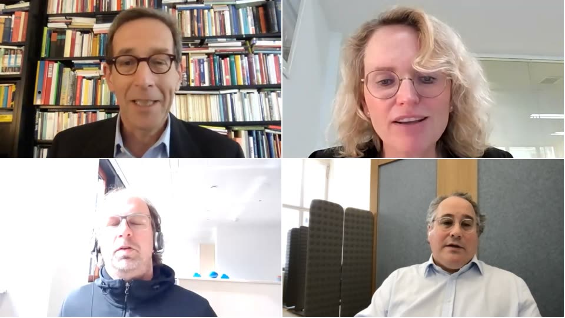Play: “EPI - Towards a Pan-European Payments Solution”, NACHA Global Payments Alliance panel with EPI CEO Martina Weimert, May 2021Plays from YouTube</a>
<figcaption>“EPI - Towards a Pan-European Payments Solution”, NACHA Global Payments Alliance panel with EPI CEO Martina Weimert, May 2021 (62 min)</figcaption></figure>
<figure><video class="video-own" controls preload="none" poster="/assets/video/salmony-interview-amsterdam-2017.jpg" width="1280" height="720"><source src="/assets/video/salmony-interview-amsterdam-2017.mp4" type="video/mp4"></video><figcaption>Interview on PSD2, Future of Payments, Amsterdam 2017 (2 min)</figcaption></figure>

<h2 id="apc">APC HardTalks and round tables</h2>

As member of the Asia Payments Connect (APC) Global Expert Council, Michael Salmony hosted the APC HardTalks and moderated APC panels and expert round tables in 2020-21, with guests such as the CEO of Jumio, Bo Harald, SAS, Ekata and Paul Brisk, on Open Banking, digital identity, data governance, CBDC and ISO 20022 ([APC site](https://asiapaymentsconnect.com/interviews-blogs/)).

<figure>
<a href="https://www.youtube.com/watch?v=gYuy131hnVw" data-yt="gYuy131hnVw" title="HardTalk: digital identity - Robert Prigge, Jumio (2020, 7 min)">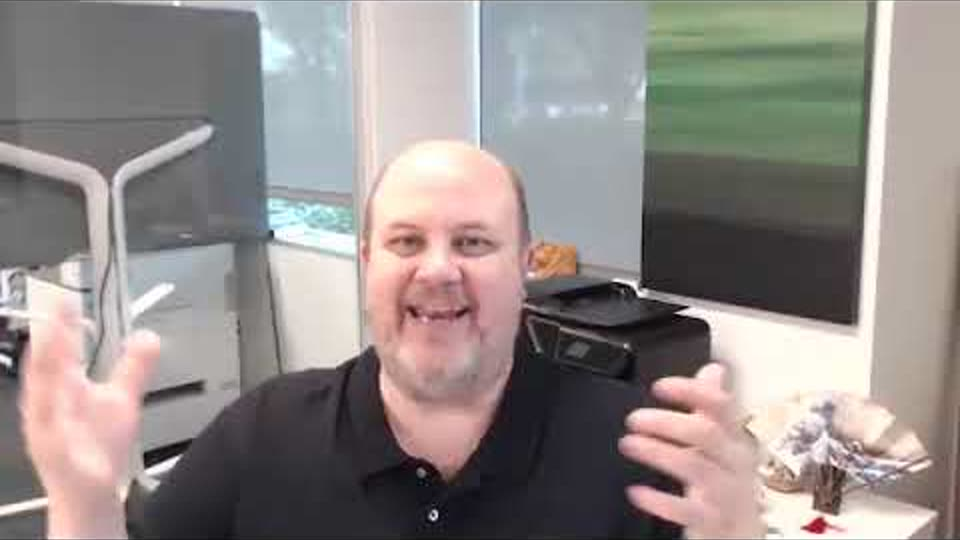Play: HardTalk: digital identity - Robert Prigge, Jumio (2020, 7 min)Plays from YouTube</a>
<figcaption>HardTalk: digital identity - Robert Prigge, Jumio (2020, 7 min)</figcaption></figure>
<figure>
<a href="https://www.youtube.com/watch?v=UBP9O0uhKvc" data-yt="UBP9O0uhKvc" title="HardTalk: Open Banking, regulator or market driven? - Paul Brisk (2020, 13 min)">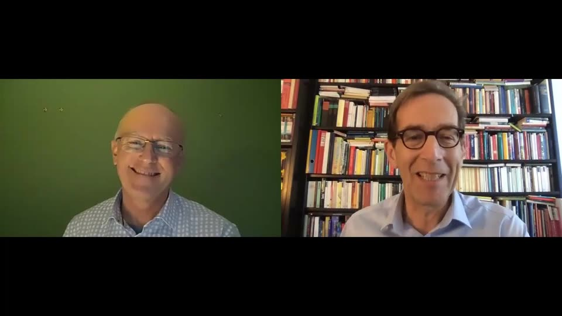Play: HardTalk: Open Banking, regulator or market driven? - Paul Brisk (2020, 13 min)Plays from YouTube</a>
<figcaption>HardTalk: Open Banking, regulator or market driven? - Paul Brisk (2020, 13 min)</figcaption></figure>
<figure>
<a href="https://www.youtube.com/watch?v=16TJX9gSaTU" data-yt="16TJX9gSaTU" title="HardTalk: data governance - Kalliopi Spyridaki, SAS (2020, 7 min)">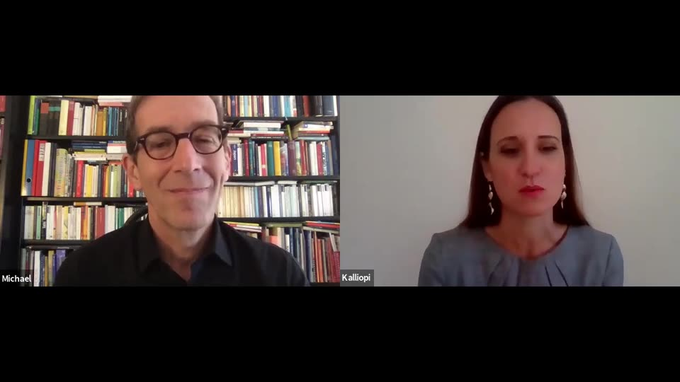Play: HardTalk: data governance - Kalliopi Spyridaki, SAS (2020, 7 min)Plays from YouTube</a>
<figcaption>HardTalk: data governance - Kalliopi Spyridaki, SAS (2020, 7 min)</figcaption></figure>
<figure>
<a href="https://www.youtube.com/watch?v=yKuIKBDP3Fg" data-yt="yKuIKBDP3Fg" title="HardTalk: the role of banks in the digital economy - Bo Harald (2020, 6 min)">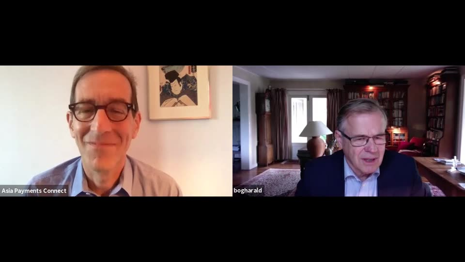Play: HardTalk: the role of banks in the digital economy - Bo Harald (2020, 6 min)Plays from YouTube</a>
<figcaption>HardTalk: the role of banks in the digital economy - Bo Harald (2020, 6 min)</figcaption></figure>
<figure>
<a href="https://www.youtube.com/watch?v=UvYQgIfNSM0" data-yt="UvYQgIfNSM0" title="HardTalk with Tom Donlea, Ekata (2021, 5 min)">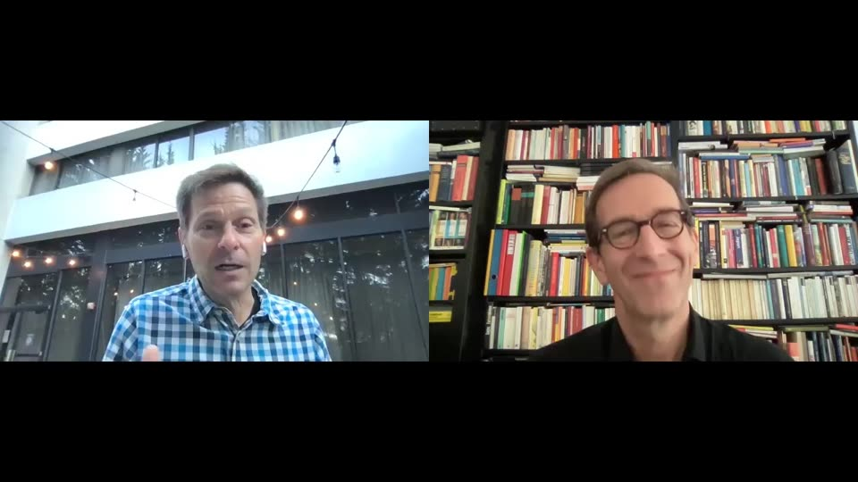Play: HardTalk with Tom Donlea, Ekata (2021, 5 min)Plays from YouTube</a>
<figcaption>HardTalk with Tom Donlea, Ekata (2021, 5 min)</figcaption></figure>
<figure>
<a href="https://www.youtube.com/watch?v=7RI7vhkGb-I" data-yt="7RI7vhkGb-I" title="Panel: has the pandemic accelerated Open Banking? (2021, 54 min)">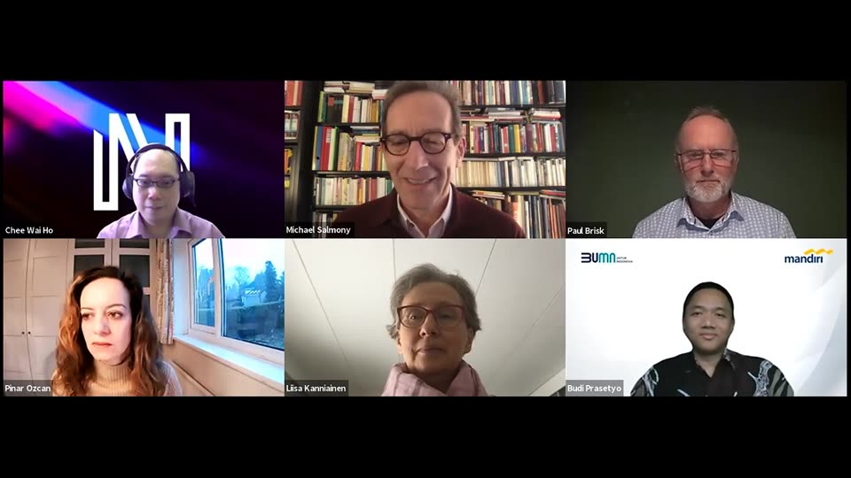Play: Panel: has the pandemic accelerated Open Banking? (2021, 54 min)Plays from YouTube</a>
<figcaption>Panel: has the pandemic accelerated Open Banking? (2021, 54 min)</figcaption></figure>
<figure>
<a href="https://www.youtube.com/watch?v=lsUFhbezjtI" data-yt="lsUFhbezjtI" title="Round table: the 4-corner model in payments (2021, 62 min)">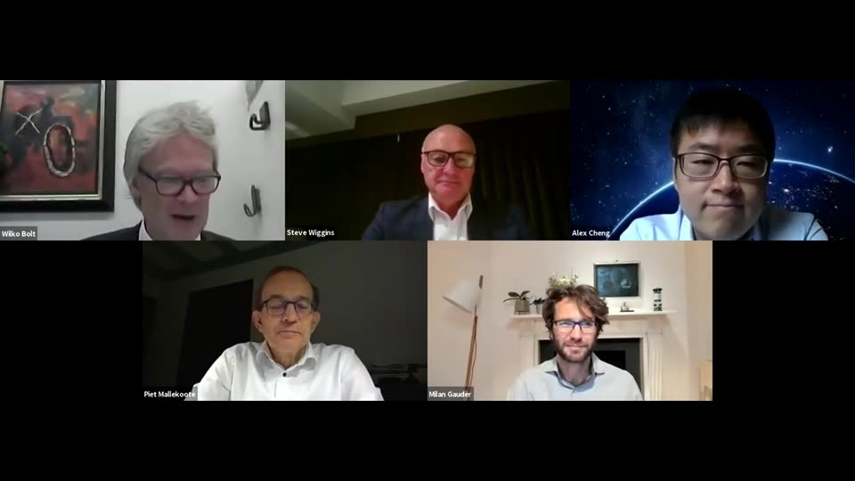Play: Round table: the 4-corner model in payments (2021, 62 min)Plays from YouTube</a>
<figcaption>Round table: the 4-corner model in payments (2021, 62 min)</figcaption></figure>
<figure>
<a href="https://www.youtube.com/watch?v=EBcgfSXJW3k" data-yt="EBcgfSXJW3k" title="Round table: ISO 20022 (2021, 58 min)">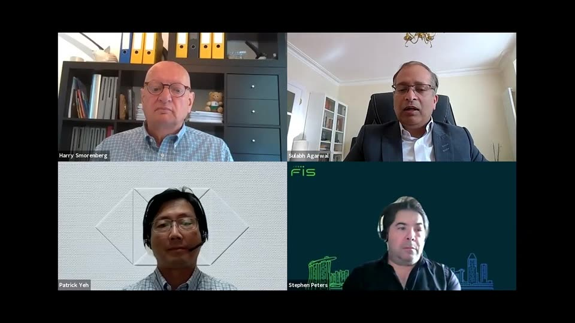Play: Round table: ISO 20022 (2021, 58 min)Plays from YouTube</a>
<figcaption>Round table: ISO 20022 (2021, 58 min)</figcaption></figure>
<figure>
<a href="https://www.youtube.com/watch?v=OgJxzSleSSA" data-yt="OgJxzSleSSA" title="Round table: data governance (2021, 80 min)">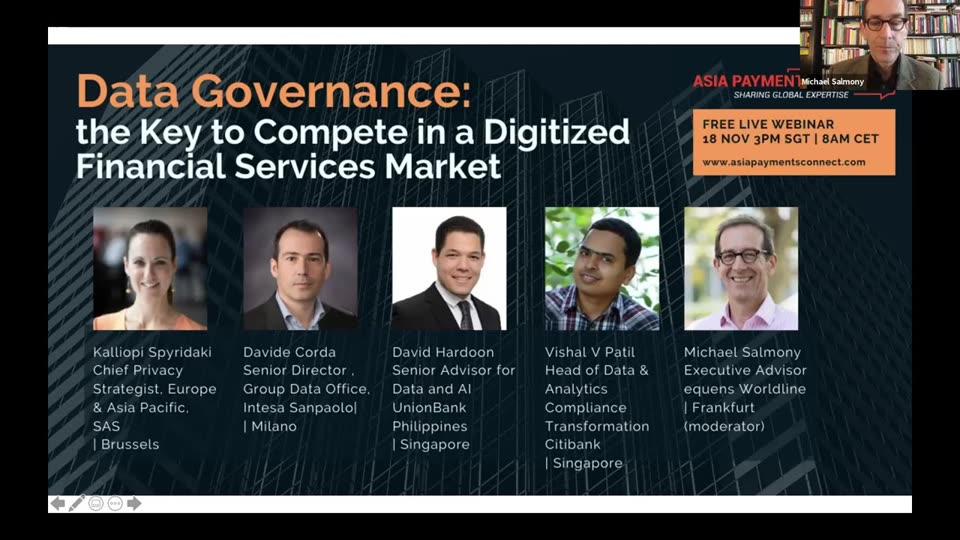Play: Round table: data governance (2021, 80 min)Plays from YouTube</a>
<figcaption>Round table: data governance (2021, 80 min)</figcaption></figure>
<figure>
<a href="https://www.youtube.com/watch?v=h3cj6njd5oM" data-yt="h3cj6njd5oM" title="Round table: CBDC - another euro, another dollar? (2021, 71 min)">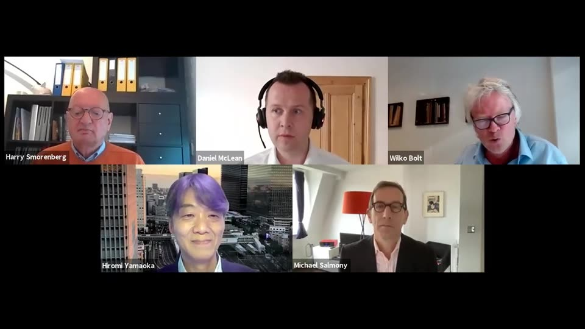Play: Round table: CBDC - another euro, another dollar? (2021, 71 min)Plays from YouTube</a>
<figcaption>Round table: CBDC - another euro, another dollar? (2021, 71 min)</figcaption></figure>

<h2 id="etppa">ETPPA “Everything FinTech” interviews</h2>

Host of the ETPPA video interview series [“Everything FinTech”](https://www.youtube.com/@etppa_channel) on YouTube, with guests from the ECB, the World Bank, EPI, the Berlin Group, Tink, Trustly, Form3 and others.

<figure>
<a href="https://www.youtube.com/watch?v=VpGZr7jU9UM" data-yt="VpGZr7jU9UM" title="Ralf Ohlhausen: introducing ETPPA (2023)">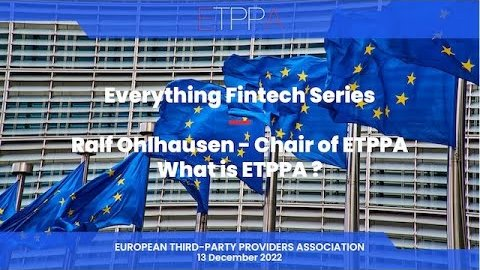Play: Ralf Ohlhausen: introducing ETPPA (2023)Plays from YouTube</a>
<figcaption>Ralf Ohlhausen: introducing ETPPA (2023, 12 min)</figcaption></figure>
<figure>
<a href="https://www.youtube.com/watch?v=tS7oQtMbp0U" data-yt="tS7oQtMbp0U" title="Ralf Ohlhausen: issues with the RTS (2023)">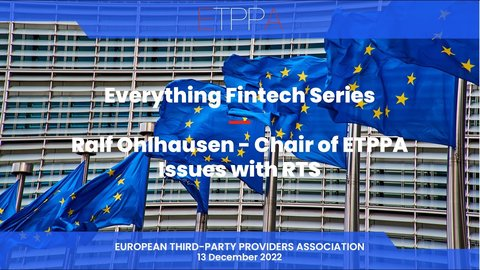Play: Ralf Ohlhausen: issues with the RTS (2023)Plays from YouTube</a>
<figcaption>Ralf Ohlhausen: issues with the RTS (2023, 12 min)</figcaption></figure>
<figure>
<a href="https://www.youtube.com/watch?v=17XqKGw9uwg" data-yt="17XqKGw9uwg" title="Arturo González Mac Dowell: SPAA (2023)">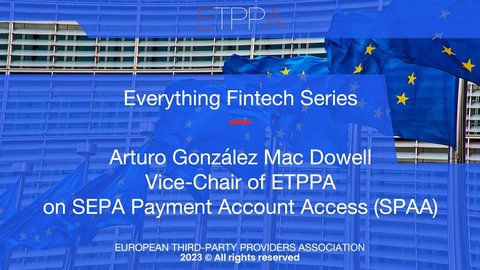Play: Arturo González Mac Dowell: SPAA (2023)Plays from YouTube</a>
<figcaption>Arturo González Mac Dowell: SPAA (2023, 11 min)</figcaption></figure>
<figure>
<a href="https://www.youtube.com/watch?v=hnkceQ3rRV0" data-yt="hnkceQ3rRV0" title="Richard Boutet: instant payments to make Open Banking work (2023)">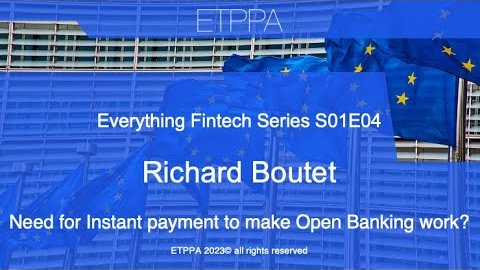Play: Richard Boutet: instant payments to make Open Banking work (2023)Plays from YouTube</a>
<figcaption>Richard Boutet: instant payments to make Open Banking work (2023, 11 min)</figcaption></figure>
<figure>
<a href="https://www.youtube.com/watch?v=Qu3cs6GTuBg" data-yt="Qu3cs6GTuBg" title="Eric Ducoulombier: advancing Open Banking in Europe (2023)">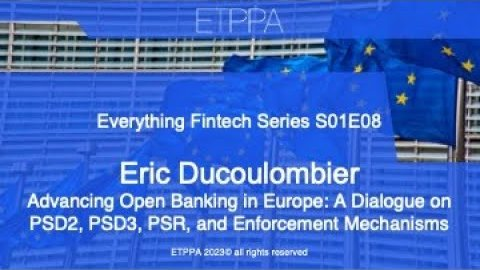Play: Eric Ducoulombier: advancing Open Banking in Europe (2023)Plays from YouTube</a>
<figcaption>Eric Ducoulombier: advancing Open Banking in Europe (2023, 12 min)</figcaption></figure>
<figure>
<a href="https://www.youtube.com/watch?v=4y8Rtaf3EGc" data-yt="4y8Rtaf3EGc" title="Pinar Ozcan, Oxford Saïd: Open Banking&#x27;s data journey (2023)">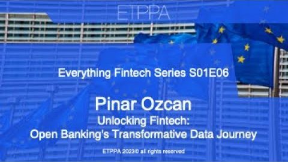Play: Pinar Ozcan, Oxford Saïd: Open Banking&#x27;s data journey (2023)Plays from YouTube</a>
<figcaption>Pinar Ozcan, Oxford Saïd: Open Banking's data journey (2023, 10 min)</figcaption></figure>
<figure>
<a href="https://www.youtube.com/watch?v=Q_v3CqdyhT0" data-yt="Q_v3CqdyhT0" title="Evelien Witlox, ECB: innovation with CBDC (2024)">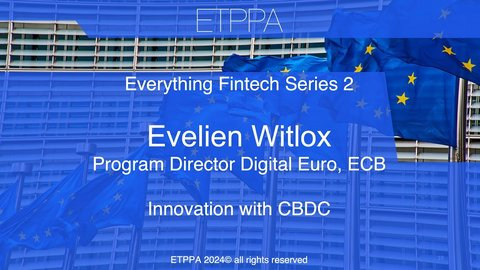Play: Evelien Witlox, ECB: innovation with CBDC (2024)Plays from YouTube</a>
<figcaption>Evelien Witlox, ECB: innovation with CBDC (2024, 12 min)</figcaption></figure>
<figure>
<a href="https://www.youtube.com/watch?v=by1GTCsqOuo" data-yt="by1GTCsqOuo" title="Jan van Vonno, Tink: the EU Identity Wallet and Open Banking (2024)">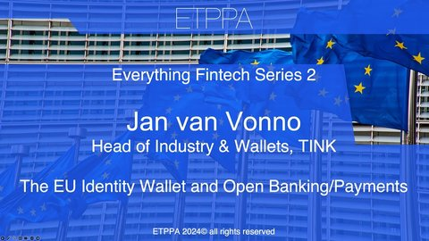Play: Jan van Vonno, Tink: the EU Identity Wallet and Open Banking (2024)Plays from YouTube</a>
<figcaption>Jan van Vonno, Tink: the EU Identity Wallet and Open Banking (2024, 11 min)</figcaption></figure>
<figure>
<a href="https://www.youtube.com/watch?v=z1wtfSVDwDE" data-yt="z1wtfSVDwDE" title="Fanny Rodriguez, Fintecture: Open Banking in France (2024)">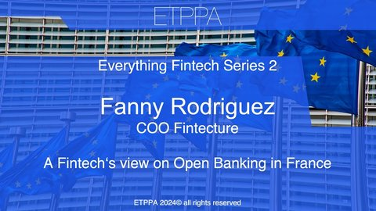Play: Fanny Rodriguez, Fintecture: Open Banking in France (2024)Plays from YouTube</a>
<figcaption>Fanny Rodriguez, Fintecture: Open Banking in France (2024, 11 min)</figcaption></figure>
<figure>
<a href="https://www.youtube.com/watch?v=BwRuim4zGSE" data-yt="BwRuim4zGSE" title="Zennon Kapron, Kapronasia: Asian super apps (2024)">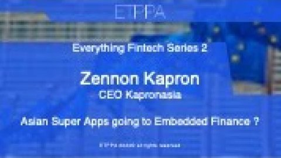Play: Zennon Kapron, Kapronasia: Asian super apps (2024)Plays from YouTube</a>
<figcaption>Zennon Kapron, Kapronasia: Asian super apps (2024, 10 min)</figcaption></figure>
<figure>
<a href="https://www.youtube.com/watch?v=LsVFfScATRI" data-yt="LsVFfScATRI" title="Thomas Vogt-Skard, Form3 (2024)">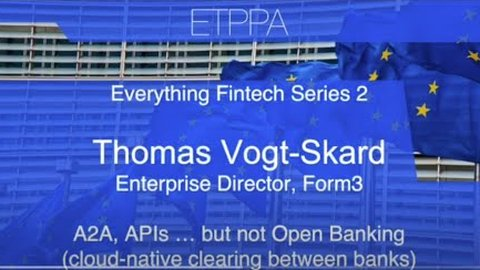Play: Thomas Vogt-Skard, Form3 (2024)Plays from YouTube</a>
<figcaption>Thomas Vogt-Skard, Form3 (2024, 11 min)</figcaption></figure>
<figure>
<a href="https://www.youtube.com/watch?v=v-dwvOVv2PY" data-yt="v-dwvOVv2PY" title="Ruth Wandhöfer: UK developments on Open Banking (2024)">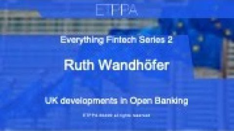Play: Ruth Wandhöfer: UK developments on Open Banking (2024)Plays from YouTube</a>
<figcaption>Ruth Wandhöfer: UK developments on Open Banking (2024, 11 min)</figcaption></figure>
<figure>
<a href="https://www.youtube.com/watch?v=i9XkP8z9HiU" data-yt="i9XkP8z9HiU" title="Oscar Berglund, Trustly: merchants&#x27; needs and Open Banking (2024)">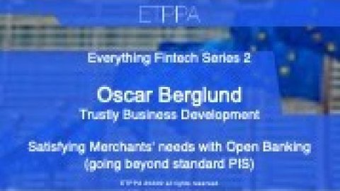Play: Oscar Berglund, Trustly: merchants&#x27; needs and Open Banking (2024)Plays from YouTube</a>
<figcaption>Oscar Berglund, Trustly: merchants' needs and Open Banking (2024, 11 min)</figcaption></figure>
<figure>
<a href="https://www.youtube.com/watch?v=lIeXolmpemo" data-yt="lIeXolmpemo" title="Marie Walker, Raidiam: trust framework for Open Banking (2024)">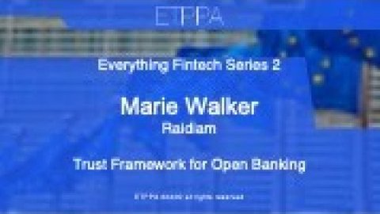Play: Marie Walker, Raidiam: trust framework for Open Banking (2024)Plays from YouTube</a>
<figcaption>Marie Walker, Raidiam: trust framework for Open Banking (2024, 12 min)</figcaption></figure>
<figure>
<a href="https://www.youtube.com/watch?v=Y_FomafdX2I" data-yt="Y_FomafdX2I" title="Wijnand Machielse, Berlin Group (2024)">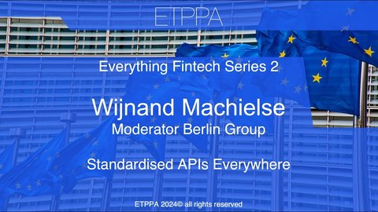Play: Wijnand Machielse, Berlin Group (2024)Plays from YouTube</a>
<figcaption>Wijnand Machielse, Berlin Group (2024, 12 min)</figcaption></figure>
<figure>
<a href="https://www.youtube.com/watch?v=6lzYe_U5p5Q" data-yt="6lzYe_U5p5Q" title="Hans-Gert Penzel: is there really demand for Open Banking? (2024)">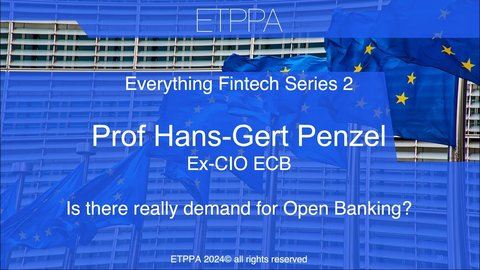Play: Hans-Gert Penzel: is there really demand for Open Banking? (2024)Plays from YouTube</a>
<figcaption>Hans-Gert Penzel: is there really demand for Open Banking? (2024, 9 min)</figcaption></figure>
<figure>
<a href="https://www.youtube.com/watch?v=nK-g81n8QW0" data-yt="nK-g81n8QW0" title="Martina Weimert, CEO of EPI: how to attain pan-European reach (2024)">Play: Martina Weimert, CEO of EPI: how to attain pan-European reach (2024)Plays from YouTube</a>
<figcaption>Martina Weimert, CEO of EPI: how to attain pan-European reach (2024, 21 min)</figcaption></figure>
<figure>
<a href="https://www.youtube.com/watch?v=kN3WuEoFuVA" data-yt="kN3WuEoFuVA" title="Christian Pirkner, EMPSA Chair (2024)">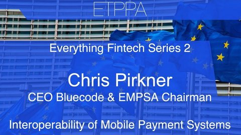Play: Christian Pirkner, EMPSA Chair (2024)Plays from YouTube</a>
<figcaption>Christian Pirkner, EMPSA Chair (2024, 12 min)</figcaption></figure>
<figure>
<a href="https://www.youtube.com/watch?v=qhzCzBrHOvk" data-yt="qhzCzBrHOvk" title="Harish Natarajan, World Bank: Open Banking in developing economies (2024)">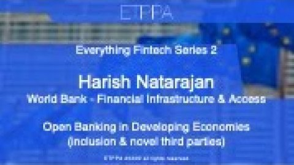Play: Harish Natarajan, World Bank: Open Banking in developing economies (2024)Plays from YouTube</a>
<figcaption>Harish Natarajan, World Bank: Open Banking in developing economies (2024, 11 min)</figcaption></figure>
<figure>
<a href="https://www.youtube.com/watch?v=9ICd4CSNlxc" data-yt="9ICd4CSNlxc" title="Bruno Cambounet, Sopra: Open Finance (2024)">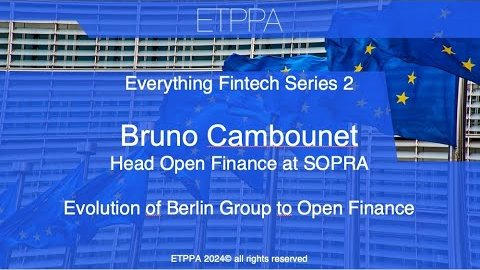Play: Bruno Cambounet, Sopra: Open Finance (2024)Plays from YouTube</a>
<figcaption>Bruno Cambounet, Sopra: Open Finance (2024, 10 min)</figcaption></figure>
<figure>
<a href="https://www.youtube.com/watch?v=mod0hj5eKR0" data-yt="mod0hj5eKR0" title="Peter Frey, Annerton: what PSD3 and PSR mean for fraud (2024)">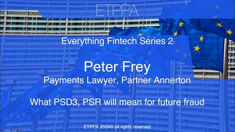Play: Peter Frey, Annerton: what PSD3 and PSR mean for fraud (2024)Plays from YouTube</a>
<figcaption>Peter Frey, Annerton: what PSD3 and PSR mean for fraud (2024, 11 min)</figcaption></figure>
<figure>
<a href="https://www.youtube.com/watch?v=uSWD3Ig2ZHo" data-yt="uSWD3Ig2ZHo" title="Shih-Wen Su, Caulis, Japan: advanced fraud defence (2025)">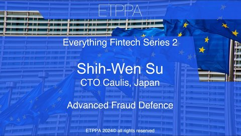Play: Shih-Wen Su, Caulis, Japan: advanced fraud defence (2025)Plays from YouTube</a>
<figcaption>Shih-Wen Su, Caulis, Japan: advanced fraud defence (2025, 12 min)</figcaption></figure>
<figure>
<a href="https://www.youtube.com/watch?v=thMEOUcWz4E" data-yt="thMEOUcWz4E" title="David Birch on digital financial services (2025)">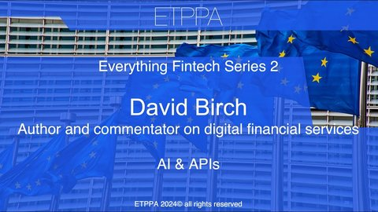Play: David Birch on digital financial services (2025)Plays from YouTube</a>
<figcaption>David Birch on digital financial services (2025, 10 min)</figcaption></figure>

<h2 id="tpt">The Payments Trilogue</h2>

Co-host of [The Payments Trilogue](https://www.youtube.com/@ThePaymentsTrilogue) podcast series, with all episodes on YouTube  

<h2 id="clips">Short clips</h2>

<figure><video class="video-own" controls preload="none" poster="/assets/video/said-2024-open-banking-like-iphone.jpg" width="1280" height="720"><source src="/assets/video/said-2024-open-banking-like-iphone.mp4" type="video/mp4"></video><figcaption>Open Banking is like the iPhone - Saïd Business School, University of Oxford, 2024 (54 sec)</figcaption></figure>
<figure><video class="video-own" controls preload="none" poster="/assets/video/said-2024-ai-and-payments.jpg" width="640" height="360"><source src="/assets/video/said-2024-ai-and-payments.mp4" type="video/mp4"></video><figcaption>AI and payments - Saïd Business School, University of Oxford, 2024 (46 sec)</figcaption></figure>
<figure><video class="video-own" controls preload="none" poster="/assets/video/said-2024-hackers-and-ai.jpg" width="640" height="360"><source src="/assets/video/said-2024-hackers-and-ai.mp4" type="video/mp4"></video><figcaption>Hackers and AI - Saïd Business School, University of Oxford, 2024 (1 min)</figcaption></figure>
<figure><video class="video-own" controls preload="none" poster="/assets/video/open-banking-teaser-turkey-2023.jpg" width="1280" height="720"><source src="/assets/video/open-banking-teaser-turkey-2023.mp4" type="video/mp4"></video><figcaption>Open Banking teaser for Turkey, 2023 (1 min)</figcaption></figure>
<figure><video class="video-own" controls preload="none" poster="/assets/video/payment-innovations-meet-e-invoicing-dubai-2023.jpg" width="1280" height="720"><source src="/assets/video/payment-innovations-meet-e-invoicing-dubai-2023.mp4" type="video/mp4"></video><figcaption>“Payment Innovations meet E-Invoicing”, preview of the closing speech at the E-Invoicing Exchange Summit, Dubai, February 2023 (1 min)</figcaption></figure>
<figure><video class="video-own" controls preload="none" poster="/assets/video/amsterdam-2022-video-talk.jpg" width="1280" height="720"><source src="/assets/video/amsterdam-2022-video-talk.mp4" type="video/mp4"></video><figcaption>Video talk for the Amsterdam Banking Forum, November 2022 (3 min)</figcaption></figure>
<figure><video class="video-own" controls preload="none" poster="/assets/video/cbdc-teaser-istanbul-tech-week-2022.jpg" width="1280" height="720"><source src="/assets/video/cbdc-teaser-istanbul-tech-week-2022.mp4" type="video/mp4"></video><figcaption>“CBDC - the future of money”, teaser for Istanbul Tech Week 2022 (1 min)</figcaption></figure>
<figure><video class="video-own" controls preload="none" poster="/assets/video/digital-finance-paycell-2022-teaser-1.jpg" width="1080" height="720"><source src="/assets/video/digital-finance-paycell-2022-teaser-1.mp4" type="video/mp4"></video><figcaption>Digital Finance seminar with Paycell/Turkcell, teaser 1, 2022 (58 sec)</figcaption></figure>
<figure><video class="video-own" controls preload="none" poster="/assets/video/digital-finance-paycell-2022-teaser-2.jpg" width="1080" height="720"><source src="/assets/video/digital-finance-paycell-2022-teaser-2.mp4" type="video/mp4"></video><figcaption>Digital Finance seminar with Paycell/Turkcell, teaser 2, 2022 (1 min)</figcaption></figure>
<figure><video class="video-own" controls preload="none" poster="/assets/video/knife-money-to-digital-new-scientist-live-2019.jpg" width="640" height="480"><source src="/assets/video/knife-money-to-digital-new-scientist-live-2019.mp4" type="video/mp4"></video><figcaption>A knife as money? (38 sec)</figcaption></figure>
<figure><video class="video-own" controls preload="none" poster="/assets/video/end-of-money-new-scientist-live-2019.jpg" width="640" height="480"><source src="/assets/video/end-of-money-new-scientist-live-2019.mp4" type="video/mp4"></video><figcaption>Thoughts on the End of Money (55 sec)</figcaption></figure>
<figure><video class="video-own" controls preload="none" poster="/assets/video/open-finance-game-changer-mena-2022.jpg" width="1280" height="720"><source src="/assets/video/open-finance-game-changer-mena-2022.mp4" type="video/mp4"></video><figcaption>“Open finance – a game-changer for the financial services industry”, MENA Open Finance Innovation Forum 2022 (46 sec)</figcaption></figure>

<figure><video class="video-own" controls preload="none" poster="/assets/video/unlocking-data-2023.jpg" width="406" height="720"><source src="/assets/video/unlocking-data-2023.mp4" type="video/mp4"></video><figcaption>Unlocking data, 2023 (41 sec)</figcaption></figure>
<figure><video class="video-own" controls preload="none" poster="/assets/video/apidays-2021-teaser.jpg" width="406" height="720"><source src="/assets/video/apidays-2021-teaser.mp4" type="video/mp4"></video><figcaption>Teaser for APIdays Helsinki 2021 on the surprising benefits of Open Banking (44 sec)</figcaption></figure>

<h2 id="press">Further press, radio, TV and podcasts</h2>

**1968** starred in “Gentlemen von der Stange” – TV programme broadcast in Germany and Switzerland about British education (Boarzell, King’s Canterbury, Eton, Cambridge) by Westdeutscher Rundfunk, Cologne

**1980s** spoken various roles in “Five o’Clock Special” – English language radio series by Süddeutscher Rundfunk, Stuttgart

**25.04.94** “Zukunft der Kommunikationstechniken” Presseöffentliches Fachgespräch mit SPD Bayern

**16.05.94** “Licht im Interaktiven Daten-Tunnel” Radiointerview Kirche im Privatfunk

**16.06.94** “Gehört der Film schon ins Museum ?” Podiumsdiskussion, Südwestfunk, Filmtage Tübingen

**11.08.94** “Elektronische Medien” Radiointerview SDR3 Schaufenster

**01.09.94** [“Interaktives Fernsehen”](/assets/uploads/2019/01/leute.pdf) – Persönliche Radiosendung “SDR3 Leute” (Audio below)

**20.09.94** “Neue Medien in Baden-Württemberg” Übertragene Podiumsdiskussion Stuttgart

**04.10.94** “Technische und nicht-technische Voraussetzungen für Interaktives Fernsehen” Film- und Fernsehproduzenten, Haus der Wirtschaft, Stuttgart

**02.02.95** “Interactive TV as seen from the Information Processing Industry”at Imagina, “Virtual Society and Information Highways”, Monte Carlo shown on French, German, Italian TV

**20.02.95** “Interaktives Fernsehen” Intendanz Südwestfunk, Baden-Baden

**08.03.00** “Green Card – The IT Personell Market in Germany” Interview with BBC World Service

**10.07.00** Strategische Allianz DG BANK/Siemens zu E-Commerce Presseerklärung, Vortrag zum strategischen Hintergrund

**22.08.00** [Interview Financial Times Deutschland “Banken](/assets/uploads/2019/01/FTD-22.8.00-page16.pdf) suchen ihre Position auf Internet-Marktplätzen” (s. 16)

**10.01.01** [Interview Financial Times Deutschland “3 Banken Modell – Vertriebsbank Szenarien”](/assets/uploads/2019/01/FTD-10.1.01-page20.pdf) (s. 20)

**11.06.01** [Pressekonferenz](/assets/uploads/2019/01/dasit.doc) mit Parl. Staatssekretärin Wolf im Bundesministerium für Forschung und Technologie  zur Ergebnispräsentation von “DASIT – Datenschutz in Telediensten”, Berlin Berichtet in Handelsblatt, Focus, Spiegel, c’t, VDI usw.

**24.01.03** Interview zu Strukturreformen in der Finanzdienstleistungsindustrie in “Who-is-Who in eFinance” durch whois Verlag

**23.10.03** Podiumsdiskussion der Systems zu Industrialisierung des Bankgeschäfts – Sourcing und Technologiestrategien als Erfolgsfaktoren. Mit Vorständen (HP, Siemens, Mircosoft, Accenture, Audi, Springer, Premiere), MdBs, Tom Groth, Thomas Middelhoff. Übertragen in n-tv und live im Internet.

**4.02.04** TV-Interview durch T-mobile zu Business und Privatanwendung von Konvergenten Endgeräten (Smart-Phone, PDA, Laptop, Konsolen) über Mobile Hochgeschwindigkeitsnetze (W-LAN, GPRS, UMTS)

**13.2.06** Radio Interview durch NDR zum Thema ePayments in Europa insb. zum neuen Verfahren Giropay in NDRinfo – Das Infomagazin zu Wirtschaft & Soziales

**18.1.07** EC E-Invoicing Group Members named First news report of many that the European Commission has named members of its Expert Group on Electronic Invoicing to develop a European Electronic Invoicing Framework by 2009

**9.8.07** [Financial Times Deutschland Bericht über Vortrag “Innovationen überrollen den Markt”](/assets/uploads/2019/01/FTD-9.8.07-page18.pdf) (s. 18)

**May 2008** Clicking the Bank Account to Buy[ Article ](/assets/uploads/2019/01/crdnpay.pdf)by Dan Balaban in Cards & Payments quoting Michael Salmony

**March 2009** interview with Dan Balaban “Cards & Payments Magazine” on the Payment Services Directive and how it will open up markets in Europe to non-banks

**May 2009** “The Market needs future proof solutions” – article with Benjamin Syrbe in B&F Payments Magazine, quoting M. Salmony

**2009** Cambridge Science Festival: VoxPop webTV recording and Question broadcast on BBC Radio4 Home Planet

**November 2009** iTunes Podcast Interview with Dave Birch, Hyperion Consult (Audio below)

**November 2011** Video extract of speech on cash at Moscow Plus Forum

**December 2011** Video interview on Innovation Management: “A more systematic way to bring successful innovations in payments” at the [CBI Conference](https://www.youtube.com/watch?v=FOXKgovPtiA) following Keynote speech at opening session at the main Italian event for the whole international community of financial services, ABI convention centre, Milan

**2013** [Video](https://www.youtube.com/watch?v=gxKPwg4uqIo) interview on [EPCA Brussels](http://vimeo.com/62737180) and [Global Payment Summit Singapore](http://vimeo.com/63513812)

**2015** Video interview on [Finextra on Financial Innovation](http://www.finextra.com/video/video.aspx?videoid=901) from NACHA Payments Innovation Alliance meeting Barcelona, also shown by Equens

**2016** Live Webinar invitation by e-finance&paymentslaw&policy Cecile Park Publishing on why Blockchain is overhyped, and how the billions Europe is investing in real-time payments may actually pay off

[“Blockchain – not for payments ?”](https://www.linkedin.com/pulse/blockchain-payments-michael-salmony?trk=pulse_spock-articles) in LinkedIn with 500 views in first week

**2017** [Video interview](https://www.youtube.com/watch?v=lWi_7ZVDbd8) at Future of Payments, Amsterdam: “PSD2 will change the world and unleash third party creativity in banking – interview Michael Salmony” with [blog](http://zelfsturing.it/psd2-will-change-the-world-and-unleash-third-party-creativity-banking-and-payments/) about my talk and scripted video interview

**2017** Video of GSMA High Level round table on FinTech, European Internet Forum, Brussels

**September 2018** Invited by The Telegraph’s Director of Programming for a filmed thought leadership interview on “The Digital Transformation” on Blockchain not for Payments

**August 2019** Podcast with figo in [PaymentAndBanking](https://paymentandbanking.com/psd2-open-banking-und-was-kommt-danach-fintech-podcast-221/) on „Open Banking – looking beyond PSD2″  
announced in tweet and Michael called [“personifizierte Cool Brittania”](https://twitter.com/joergjessen/status/1164894565767290881)

**2019** Massive social media promotions for New Scientist Live (see the short clips above)

**2019** Interviewed by bull.io Blockchain Media at New Scientist Live on Technology and Society

**October 2019** equensWorldine CMO Alessandro Baroni Finextra SIBOS interview [“Identity is bigger than payments”](https://www.finextra.com/videoarticle/2209/identity-is-bigger-than-payments?utm_medium=videoflash&utm_source=2019-10-8&member=98091)

**April 2020** Cited by EPA Emerging Payments Association whitepaper ‘unleashing the potential of open banking’

**2020** Interviewed by Celent for the report on “Barriers to adoption of Open Banking in Europe”

**June 2020** Video interview by head of Emerging Payments and Business Development in Citi’s Treasury and Trade Solutions on the business and payments landscape post Covid. “As articulate and thoughtful as always”. [Promoted by Citi](https://www.linkedin.com/posts/tony-mclaughlin-7b627a3_citi-talks-payments-episode-1-activity-6676997327305138178-iSF8) as kicking off Citi’s series on what “the most insightful people in the world” say about the future of payments. Republished on LinkedIn and [Twitter](https://twitter.com/eW_eu/status/1275326334370226176?s=20) by [equensWorldline](https://www.youtube.com/embed/TPYu1tDvUe0?rel=0&autoplay=1)

**July 2020** Interview by New Money Review on developments in digital finance, payments, innovation “breaking the grip of the platforms”

Interview as leading industry expert by Consult Hyperion for Emerging Payments Association “Banking on Open Payments” report

Interview by  Frankfurt School of Finance & Management on “Banks’ Strategic Options in the Light of PSD2 – A Value Chain Analysis””

**November 2023** [“Are you ready for Digital Identity ?”](https://www.linkedin.com/posts/daviddaly-fbcs-citp_are-you-ready-for-digital-identity-activity-7127583648966430720-ajTL/?utm_source=share&utm_medium=member_ios), interview as the “extremely knowledgeable and entertaining” interviewee in Worldline’s “Navigating Digital Payments” podcast series.  
Available on [Spotify](https://lnkd.in/e-FubeZx), [Apple](https://lnkd.in/e8JUNXRN), [Worldline](https://worldline.com/en/home/main-navigation/resources/resources-hub/podcasts/are-you-ready-for-digital-identity.html), etc

**February 2025** [Interview](https://www.linkedin.com/posts/payments-innovation-technology-currency-research_pitexchange-paymentsinnovation-technology-activity-7293550494608691200-YECd/?utm_source=share&utm_medium=member_ios&rcm=ACoAAACtqB4BWhjRNUzjWjzD423gigMJLhHB5AU) on Digital Assets with Currency Research

**May-September 2025** Streamly video series on debunking myths in payments  
[1) Don’t ask the customer](https://streamly.video/video/what-they-don-t-tell-you-about-customer-feedback)  
[LinkedIn](https://www.linkedin.com/posts/activity-7331988663179923456-4f9e?utm_source=share&utm_medium=member_desktop&rcm=ACoAAACtqB4BWhjRNUzjWjzD423gigMJLhHB5AU)  
[2) The money is not in consumer products and services (it’s in B2B)](https://streamly.video/video/what-they-don-t-tell-you-about-consumer-goldmines)  
[LinkedIn](https://www.linkedin.com/feed/update/urn:li:share:7363165415792910337/)  
[3) Regulation is not an innovation killer](https://streamly.video/video/what-they-don-t-tell-you-about-regulation-being-an-innovation-killer)  
[LinkedIn](https://www.linkedin.com/posts/activity-7372170276534661120-pZiH)

**June 2026** Quick-fire responses to [Finternet](https://www.linkedin.com/posts/finternetasia_quick-takes-on-cbdcs-stablecoin-and-regulation-activity-7467794894703677440-SlA-?utm_source=share&utm_medium=member_desktop&rcm=ACoAAACtqB4BWhjRNUzjWjzD423gigMJLhHB5AU)

**June 2026** Subset of interview on book with [Finternet](https://www.linkedin.com/posts/dr-michael-salmony-on-his-new-book-published-ugcPost-7470025727174787072-XfaZ/?utm_source=share&utm_medium=member_ios&rcm=ACoAAACtqB4BWhjRNUzjWjzD423gigMJLhHB5AU)

**June 2026** [Article](https://thepaypers.com/crypto-web3-and-cbdc/interviews/stablecoins-cbdcs-and-tokenised-deposits-the-new-playbook-for-financial-institutions) and [Webinar](https://www.youtube.com/watch?v=RN1HiZnfbBc&source_ve_path=OTY3MTQ&embeds_referring_euri=https%3A%2F%2Fthepaypers.com%2F) with co-editors on the book at The Paypers  
[LinkedIn](https://www.linkedin.com/posts/mirela-c-33781741_banking-tokenization-stablecoins-ugcPost-7472273535336542208-Q0ro/?utm_source=share&utm_medium=member_ios&rcm=ACoAAACtqB4BWhjRNUzjWjzD423gigMJLhHB5AU)

**July 2026** Interview on book at [Fintech Decoded](https://www.youtube.com/@FinstepAsia) with 60,000 subscribers on [Youtube](https://youtu.be/XZOTmkPw_0A?si=jEYS2K6Hkp4DpWqT)  
[LinkedIn](https://www.linkedin.com/posts/episode14-from-cbdcs-to-stablecoins-the-share-7479814770569785344-YYog/?utm_source=share&utm_medium=member_ios&rcm=ACoAAACtqB4BWhjRNUzjWjzD423gigMJLhHB5AU) promotion and [again](https://www.linkedin.com/posts/episode14-from-cbdcs-to-stablecoins-the-share-7500815318383005697-brqK/?utm_source=share&utm_medium=member_ios&rcm=ACoAAACtqB4BWhjRNUzjWjzD423gigMJLhHB5AU) – here is the [video](https://www.youtube.com/watch?v=XZOTmkPw_0A)

**September 2026** [Interview](https://fintechistanbul.org/2026/09/01/soylesi-michael-salmony-ile-tokenizasyon-ve-central-bank-payments-conference-2026-hakkinda/) at CR Istanbul about Tokenisation & book by Fintech Istanbul

**November 2026** [Report](https://fintechistanbul.org/2026/11/20/dr-michael-salmony-singapore-fintech-festival-2026da-teknoloji-kadar-finansal-duzenlemeler-de-gundemdeydi/) by Fintech Istanbul on Michael Salmony's impressions of the Singapore FinTech Festival 2026: AI, tokenisation and quantum as the main themes, with financial regulation drawing as much attention as technology
