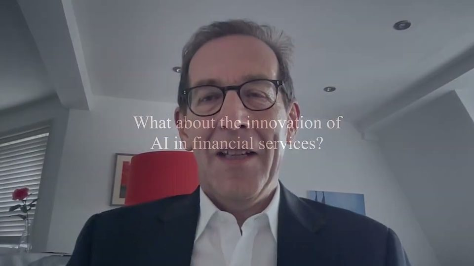
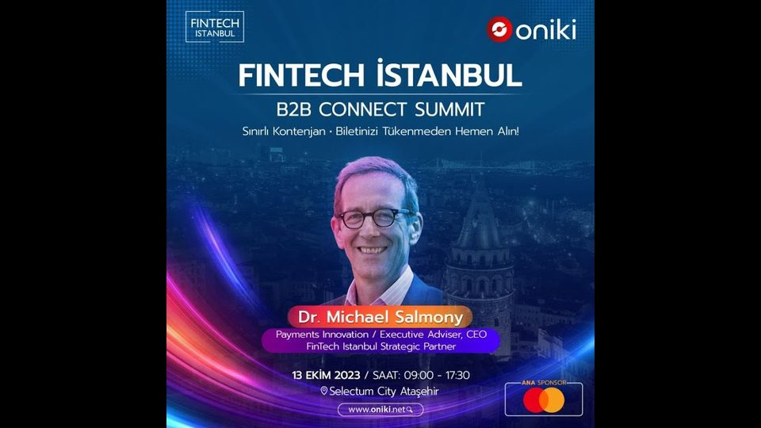
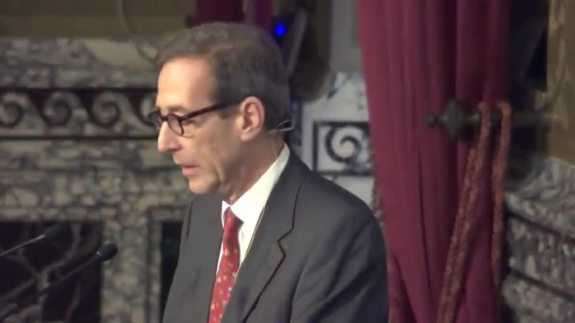
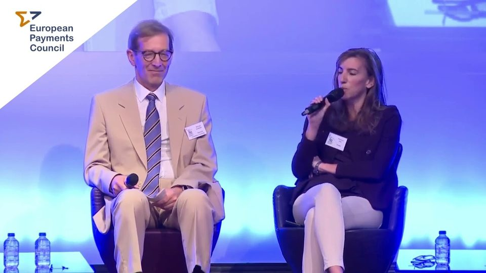
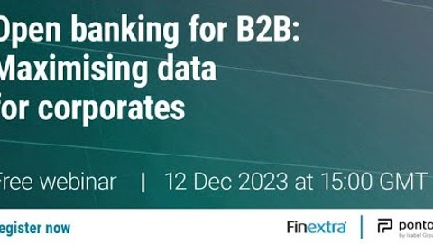
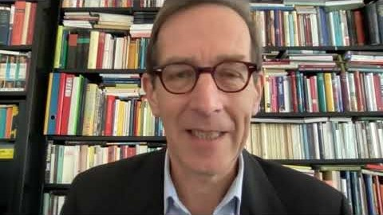
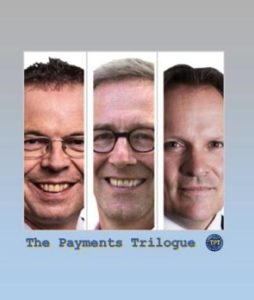

Appearances in T.V, Radio, Podcasts and other media, This section is not including the [lectures](/lectures/) that were recorded or broadcast.

Selected awards and nominations are listed under [public announcements](/announcements/).

------------------------------------------------------------------------

### Portrait Michael Salmony

<video class="video-own" controls preload="none" poster="/assets/video/portrait-michael-salmony.jpg" width="1280" height="720"><source src="/assets/video/portrait-michael-salmony.mp4" type="video/mp4"></video>

### Interview at Saïd Business School, Oxford, 2024

Interviewed at Saïd Business School, University of Oxford, on Open Banking, Open Finance and AI

<a href="https://www.youtube.com/watch?v=fAfjzIb-D_M" data-yt="fAfjzIb-D_M" title="Interview at Saïd Business School, Oxford, 2024">Play: Interview at Saïd Business School, Oxford, 2024Plays from YouTube</a>

<h3 id="istanbul-b2b-keynote">Keynote at the FinTech Istanbul B2B Connect Summit, October 2023</h3>

Keynote at the FinTech Istanbul B2B Connect Summit, Istanbul, 13th October 2023 ([report by FinTech Istanbul](https://fintechistanbul.org/en/2023/10/02/financial-technology-world-is-coming-together-at-fintech-istanbul-b2b-connect-summit/))

<a href="https://www.youtube.com/watch?v=6XFpVBKw7Mc" data-yt="6XFpVBKw7Mc" title="Keynote at the FinTech Istanbul B2B Connect Summit 2023">Play: Keynote at the FinTech Istanbul B2B Connect Summit 2023Plays from YouTube</a>

### European Parliament hearing, March 2016

Salmony as Chair of Public Hearing on “How can we make the most of the opportunities presented by innovation?” for the European Commission’s Green Paper on Retail Financial Services with Lord Hill and 500 invited members at European Parliament March 2016

<a href="https://www.youtube.com/watch?v=AE0BXH5KdOM" data-yt="AE0BXH5KdOM" title="European Parliament hearing, March 2016">Play: European Parliament hearing, March 2016Plays from YouTube</a>

### Salmony at ECB Conference 2017

<a href="https://www.youtube.com/watch?v=bh9RFnCpVNE" data-yt="bh9RFnCpVNE" title="Salmony at ECB Conference 2017">Play: Salmony at ECB Conference 2017Plays from YouTube</a>

### Technology panel at the EPC 20th Anniversary event, June 2022

Chair of executive banking panel on “Technology - a threat and an opportunity?” with Google, Nexi, Banco Santander and BEUC at the European Payments Council’s 20th Anniversary event, Brussels

<a href="https://www.youtube.com/watch?v=CvpcvQlUF6s" data-yt="CvpcvQlUF6s" title="Technology panel at the EPC 20th Anniversary event, June 2022">Play: Technology panel at the EPC 20th Anniversary event, June 2022Plays from YouTube</a>

### Fireside chat on Open Banking, Mastercard LAC (Latin America and Caribbean) Innovation Forum RISE, Florida, 2021

<a href="https://www.youtube.com/watch?v=_DoOGix1m94" data-yt="_DoOGix1m94" title="Fireside chat on Open Banking, Mastercard LAC (Latin America and Caribbean) Innovation Forum RISE, Florida, 2021">Play: Fireside chat on Open Banking, Mastercard LAC (Latin America and Caribbean) Innovation Forum RISE, Florida, 2021Plays from YouTube</a>

### Panel on Open Banking for B2B, Finextra webinar, December 2023

“Open Banking for B2B: Maximising data for corporates”, Finextra webinar organised by Isabel/Ponto with BNY Mellon, 12th December 2023

<a href="https://www.youtube.com/watch?v=WLu5VbCPvws" data-yt="WLu5VbCPvws" title="Open Banking for B2B, Finextra webinar, December 2023">Play: Open Banking for B2B, Finextra webinar, December 2023Plays from YouTube</a>

### CBDC at BizzPay 9.0 Payments Forum, May 2021

“CBDC – will the “mouton à cinq pattes” fly?”, BizzPay 9.0 Payments Forum, The Hague, 28th May 2021

<a href="https://www.youtube.com/watch?v=iVl8K5Wfz-A" data-yt="iVl8K5Wfz-A" title="CBDC at BizzPay 9.0 Payments Forum, May 2021">Play: CBDC at BizzPay 9.0 Payments Forum, May 2021Plays from YouTube</a>

### “The End of Money” at New Scientist Live, London, October 2019

Talk at New Scientist Live, the science festival with an audience of 40,000, London, October 2019 (recording by Worldline)

<a href="https://www.youtube.com/watch?v=_-38Q_FAN0Q" data-yt="_-38Q_FAN0Q" title="“The End of Money”, New Scientist Live 2019">Play: “The End of Money”, New Scientist Live 2019Plays from YouTube</a>

### Interview on PSD2, Amsterdam 2017

<video class="video-own" controls preload="none" poster="/assets/video/salmony-interview-amsterdam-2017.jpg" width="1280" height="720"><source src="/assets/video/salmony-interview-amsterdam-2017.mp4" type="video/mp4"></video>

### Short clips

<figure><video class="video-own" controls preload="none" poster="/assets/video/said-2024-open-banking-like-iphone.jpg" width="1280" height="720"><source src="/assets/video/said-2024-open-banking-like-iphone.mp4" type="video/mp4"></video><figcaption>Open Banking is like the iPhone - Saïd Business School, University of Oxford, 2024</figcaption></figure>
<figure><video class="video-own" controls preload="none" poster="/assets/video/said-2024-ai-and-payments.jpg" width="640" height="360"><source src="/assets/video/said-2024-ai-and-payments.mp4" type="video/mp4"></video><figcaption>AI and payments - Saïd Business School, University of Oxford, 2024</figcaption></figure>
<figure><video class="video-own" controls preload="none" poster="/assets/video/said-2024-hackers-and-ai.jpg" width="640" height="360"><source src="/assets/video/said-2024-hackers-and-ai.mp4" type="video/mp4"></video><figcaption>Hackers and AI - Saïd Business School, University of Oxford, 2024</figcaption></figure>
<figure><video class="video-own" controls preload="none" poster="/assets/video/open-banking-teaser-turkey-2023.jpg" width="1280" height="720"><source src="/assets/video/open-banking-teaser-turkey-2023.mp4" type="video/mp4"></video><figcaption>Open Banking teaser for Turkey, 2023</figcaption></figure>
<figure><video class="video-own" controls preload="none" poster="/assets/video/unlocking-data-2023.jpg" width="406" height="720"><source src="/assets/video/unlocking-data-2023.mp4" type="video/mp4"></video><figcaption>Unlocking data, 2023</figcaption></figure>
<figure><video class="video-own" controls preload="none" poster="/assets/video/payment-innovations-meet-e-invoicing-dubai-2023.jpg" width="1280" height="720"><source src="/assets/video/payment-innovations-meet-e-invoicing-dubai-2023.mp4" type="video/mp4"></video><figcaption>“Payment Innovations meet E-Invoicing”, preview of the closing speech at the E-Invoicing Exchange Summit, Dubai, February 2023</figcaption></figure>
<figure><video class="video-own" controls preload="none" poster="/assets/video/amsterdam-2022-video-talk.jpg" width="1280" height="720"><source src="/assets/video/amsterdam-2022-video-talk.mp4" type="video/mp4"></video><figcaption>Video talk for Amsterdam, November 2022 (3 minutes)</figcaption></figure>
<figure><video class="video-own" controls preload="none" poster="/assets/video/cbdc-teaser-istanbul-tech-week-2022.jpg" width="1280" height="720"><source src="/assets/video/cbdc-teaser-istanbul-tech-week-2022.mp4" type="video/mp4"></video><figcaption>“CBDC - the future of money”, teaser for Istanbul Tech Week 2022</figcaption></figure>
<figure><video class="video-own" controls preload="none" poster="/assets/video/digital-finance-paycell-2022-teaser-1.jpg" width="1080" height="720"><source src="/assets/video/digital-finance-paycell-2022-teaser-1.mp4" type="video/mp4"></video><figcaption>Digital Finance seminar with Paycell/Turkcell, teaser 1, 2022</figcaption></figure>
<figure><video class="video-own" controls preload="none" poster="/assets/video/digital-finance-paycell-2022-teaser-2.jpg" width="1080" height="720"><source src="/assets/video/digital-finance-paycell-2022-teaser-2.mp4" type="video/mp4"></video><figcaption>Digital Finance seminar with Paycell/Turkcell, teaser 2, 2022</figcaption></figure>
<figure><video class="video-own" controls preload="none" poster="/assets/video/apidays-2021-teaser.jpg" width="406" height="720"><source src="/assets/video/apidays-2021-teaser.mp4" type="video/mp4"></video><figcaption>Teaser for APIdays Helsinki 2021 on the surprising benefits of Open Banking</figcaption></figure>
<figure><video class="video-own" controls preload="none" poster="/assets/video/knife-money-to-digital-new-scientist-live-2019.jpg" width="640" height="480"><source src="/assets/video/knife-money-to-digital-new-scientist-live-2019.mp4" type="video/mp4"></video><figcaption>From knife money to digital, teaser for New Scientist Live 2019</figcaption></figure>
<figure><video class="video-own" controls preload="none" poster="/assets/video/end-of-money-new-scientist-live-2019.jpg" width="640" height="480"><source src="/assets/video/end-of-money-new-scientist-live-2019.mp4" type="video/mp4"></video><figcaption>“The End of Money”, teaser for New Scientist Live 2019</figcaption></figure>
<figure><video class="video-own" controls preload="none" poster="/assets/video/open-finance-game-changer-mena-2022.jpg" width="1280" height="720"><source src="/assets/video/open-finance-game-changer-mena-2022.mp4" type="video/mp4"></video><figcaption>“Open finance – a game-changer for the financial services industry”, MENA Open Finance Innovation Forum 2022</figcaption></figure>

------------------------------------------------------------------------

**1968** starred in “Gentlemen von der Stange” – TV programme broadcast in Germany and Switzerland about British education (Boarzell, King’s Canterbury, Eton, Cambridge) by Westdeutscher Rundfunk, Cologne

**1980**s spoken various roles in “Five o’Clock Special” – English language radio series by Süddeutscher Rundfunk, Stuttgart

**16.05.94** “Licht im Interaktiven Daten-Tunnel” Radiointerview Kirche im Privatfunk

**25.04.94** “Zukunft der Kommunikationstechniken” Presseöffentliches Fachgespräch mit SPD Bayern

**01.09.94** [“Interaktives Fernsehen”](/assets/uploads/2019/01/leute.pdf) – Persönliche Radiosendung “SDR3 Leute” (Audio below)

**16.06.94** “Gehört der Film schon ins Museum ?” Podiumsdiskussion, Südwestfunk, Filmtage Tübingen

**11.08.94** “Elektronische Medien” Radiointerview SDR3 Schaufenster

**20.09.94** “Neue Medien in Baden-Württemberg” Übertragene Podiumsdiskussion Stuttgart

**04.10.94** “Technische und nicht-technische Voraussetzungen für Interaktives Fernsehen” Film- und Fernsehproduzenten, Haus der Wirtschaft, Stuttgart

**02.02.95** “Interactive TV as seen from the Information Processing Industry”at Imagina, “Virtual Society and Information Highways”, Monte Carlo shown on French, German, Italian TV

**20.02.95** “Interaktives Fernsehen” Intendanz Südwestfunk, Baden-Baden

**08.03.00** “Green Card – The IT Personell Market in Germany” Interview with BBC World Service

**10.07.00** Strategische Allianz DG BANK/Siemens zu E-Commerce Presseerklärung, Vortrag zum strategischen Hintergrund

**22.08.00** [Interview Financial Times Deutschland “Banken](/assets/uploads/2019/01/FTD-22.8.00-page16.pdf) suchen ihre Position auf Internet-Marktplätzen” (s. 16)

**10.01.01** [Interview Financial Times Deutschland “3 Banken Modell – Vertriebsbank Szenarien”](/assets/uploads/2019/01/FTD-10.1.01-page20.pdf) (s. 20)

**11.06.01** [Pressekonferenz](/assets/uploads/2019/01/dasit.doc) mit Parl. Staatssekretärin Wolf im Bundesministerium für Forschung und Technologie  zur Ergebnispräsentation von “DASIT – Datenschutz in Telediensten”, Berlin Berichtet in Handelsblatt, Focus, Spiegel, c’t, VDI usw.

**24.01.03** Interview zu Strukturreformen in der Finanzdienstleistungsindustrie in “Who-is-Who in eFinance” durch whois Verlag

**23.10.03** Podiumsdiskussion der Systems zu Industrialisierung des Bankgeschäfts – Sourcing und Technologiestrategien als Erfolgsfaktoren. Mit Vorständen (HP, Siemens, Mircosoft, Accenture, Audi, Springer, Premiere), MdBs, Tom Groth, Thomas Middelhoff. Übertragen in n-tv und live im Internet.

**4.02.04** TV-Interview durch T-mobile zu Business und Privatanwendung von Konvergenten Endgeräten (Smart-Phone, PDA, Laptop, Konsolen) über Mobile Hochgeschwindigkeitsnetze (W-LAN, GPRS, UMTS)

**13.2.06** Radio Interview durch NDR zum Thema ePayments in Europa insb. zum neuen Verfahren Giropay in NDRinfo – Das Infomagazin zu Wirtschaft & Soziales

**9.8.07** [Financial Times Deutschland Bericht über Vortrag “Innovationen überrollen den Markt”](/assets/uploads/2019/01/FTD-9.8.07-page18.pdf) (s. 18)

**18.1.07** EC E-Invoicing Group Members named First news report of many that the European Commission has named members of its Expert Group on Electronic Invoicing to develop a European Electronic Invoicing Framework by 2009

**May 2008** Clicking the Bank Account to Buy[ Article ](/assets/uploads/2019/01/crdnpay.pdf)by Dan Balaban in Cards & Payments quoting Michael Salmony

**May 2009** “The Market needs future proof solutions” – article with Benjamin Syrbe in B&F Payments Magazine, quoting M. Salmony

**November 2009** iTunes Podcast Interview with Dave Birch, Hyperion Consult (Audio below)

**March 2009** interview with Dan Balaban “Cards & Payments Magazine” on the Payment Services Directive and how it will open up markets in Europe to non-banks

Cambridge Science Festival 2009: VoxPop webTV recording and Question broadcast on BBC Radio4 Home Planet

Video extract of speech on cash at Moscow Plus Forum, Nov 2011

Video interview on Innovation Management: “A more systematic way to bring successful innovations in payments” at Dec 2011 [CBI Conference](https://www.youtube.com/watch?v=FOXKgovPtiA) following Keynote speech at opening session at the main Italian event for the whole international community of financial services, ABI convention centre, Milan

[Video](https://www.youtube.com/watch?v=gxKPwg4uqIo) interview on [EPCA Brussels](http://vimeo.com/62737180) and [Global Payment Summit Singapore](http://vimeo.com/63513812) 2013

Video interview on [Finextra on Financial Innovation](http://www.finextra.com/video/video.aspx?videoid=901) from NACHA Payments Innovation Alliance meeting Barcelona 2015, also shown by Equens

[M. Salmony ](https://www.youtube.com/watch?v=tGtcx3vgSek&ab_channel=MichaelS)promotion by Equens 2014

Live Webinar invitation by e-finance&paymentslaw&policy Cecile Park Publishing on why Blockchain is overhyped, and how the billions Europe is investing in real-time payments may actually pay off, 2016

[Live stream](https://scic.ec.europa.eu/streaming/public-hearing-on-green-paper-on-retail-financial-services) of European Commission’s Public Hearing on the Green Paper on Retail Financial Services on Financial Stability, Financial Services and Capital Markets Union, with Lord Hill and of 500 invited members at the European Parliament, Brussels.

[Video](https://youtu.be/AE0BXH5KdOM), Michael Salmony leading  panel on Innovation

[“Blockchain – not for payments ?”](https://www.linkedin.com/pulse/blockchain-payments-michael-salmony?trk=pulse_spock-articles) in LinkedIn with 500 views in first week

[Video interview](https://www.youtube.com/watch?v=VVgnG0Uw-uI&feature=youtu.be) at Future of Payments, Amsterdam 2017. and [another](https://www.youtube.com/watch?v=lWi_7ZVDbd8): “PSD2 will change the world and unleash third party creativity in banking – interview Michael Salmony” with [blog](http://zelfsturing.it/psd2-will-change-the-world-and-unleash-third-party-creativity-banking-and-payments/) about my talk and scripted video interview

Video of GSMA [High Level round table](https://www.youtube.com/watch?v=DHBvTCjdpuI) on FinTech, European Internet Forum, Brussels 2017  
Invited by The Telegraph’s Director of Programming for a filmed thought leadership interview on “The Digital Transformation” on Blockchain not for Payments, Sept 2018

Podcast with figo in [PaymentAndBanking](https://paymentandbanking.com/psd2-open-banking-und-was-kommt-danach-fintech-podcast-221/) on „Open Banking – looking beyond PSD2″  
announced in tweet and Michael called [“personifizierte Cool Brittania”](https://twitter.com/joergjessen/status/1164894565767290881)

Massive Social Media promotions ([my talk](https://www.youtube.com/watch?v=kdsgxCZefnU), [payment technology](https://www.youtube.com/watch?v=ZznZE2yaqDg)) for New Scientist Live 2019

Interviewed by bull.io Blockchain Media at New Scientist Live 2019 on Technology and Society

equensWorldine CMO Alessandro Baroni Finextra SIBOS 2019 interview [“Identity is bigger than payments”](https://www.finextra.com/videoarticle/2209/identity-is-bigger-than-payments?utm_medium=videoflash&utm_source=2019-10-8&member=98091)

Cited by EPA Emerging Payments Association whitepaper ‘unleashing the potential of open banking’ 2020

Interview as leading industry expert by Consult Hyperion for Emerging Payments Association “Banking on Open Payments” report

Interviewed by Celent for 2020 for report on “Barriers to adoption of Open Banking in Europe”

Video interview by head of Emerging Payments and Business Development in Citi’s Treasury and Trade Solutions on the business and payments landscape post Covid. “As articulate and thoughtful as always”. [Promoted by Citi](https://www.linkedin.com/posts/tony-mclaughlin-7b627a3_citi-talks-payments-episode-1-activity-6676997327305138178-iSF8) as kicking off Citi’s series on what “the most insightful people in the world” say about the future of payments. Republished on LinkedIn and [Twitter](https://twitter.com/eW_eu/status/1275326334370226176?s=20) by [equensWorldline](https://www.youtube.com/embed/TPYu1tDvUe0?rel=0&autoplay=1)

Interview by New Money Review on developments in digital finance, payments, innovation “breaking the grip of the platforms”

Interview by  Frankfurt School of Finance & Management on “Banks’ Strategic Options in the Light of PSD2 – A Value Chain Analysis””

Hard Talk on Market- vs Regulatory-driven Open Banking with Paul Brisk, Indonesia

Embarking on [Open Banking across the World](https://www.youtube.com/watch?v=EKfrq_McMHs&t=45s&ab_channel=AQMEN365), MENA

[“Are you ready for Digital Identity ?”](https://www.linkedin.com/posts/daviddaly-fbcs-citp_are-you-ready-for-digital-identity-activity-7127583648966430720-ajTL/?utm_source=share&utm_medium=member_ios), interview as the “extremely knowledgeable and entertaining” interviewee in Worldline’s “Navigating Digital Payments” podcast series.  
Available on [Spotify](https://lnkd.in/e-FubeZx), [Apple](https://lnkd.in/e8JUNXRN), [Worldline](https://worldline.com/en/home/main-navigation/resources/resources-hub/podcasts/are-you-ready-for-digital-identity.html), etc

[Interview](https://www.linkedin.com/posts/payments-innovation-technology-currency-research_pitexchange-paymentsinnovation-technology-activity-7293550494608691200-YECd/?utm_source=share&utm_medium=member_ios&rcm=ACoAAACtqB4BWhjRNUzjWjzD423gigMJLhHB5AU) on Digital Assets with Currency Research

Streamly video series on debunking myths in payments  
[1) Don’t ask the customer](https://streamly.video/video/what-they-don-t-tell-you-about-customer-feedback)  
[LinkedIn](https://www.linkedin.com/posts/activity-7331988663179923456-4f9e?utm_source=share&utm_medium=member_desktop&rcm=ACoAAACtqB4BWhjRNUzjWjzD423gigMJLhHB5AU)  
[2) The money is not in consumer products and services (it’s in B2B)](https://streamly.video/video/what-they-don-t-tell-you-about-consumer-goldmines)  
[LinkedIn](https://www.linkedin.com/feed/update/urn:li:share:7363165415792910337/)  
[3) Regulation is not an innovation killer](https://streamly.video/video/what-they-don-t-tell-you-about-regulation-being-an-innovation-killer)  
[LinkedIn](https://www.linkedin.com/posts/activity-7372170276534661120-pZiH)

Quick-fire responses to [Finternet](https://www.linkedin.com/posts/finternetasia_quick-takes-on-cbdcs-stablecoin-and-regulation-activity-7467794894703677440-SlA-?utm_source=share&utm_medium=member_desktop&rcm=ACoAAACtqB4BWhjRNUzjWjzD423gigMJLhHB5AU)

Interview on book at [Fintech Decoded](https://www.youtube.com/@FinstepAsia) with 60,000 subscribers on [Youtube](https://youtu.be/XZOTmkPw_0A?si=jEYS2K6Hkp4DpWqT)  
[LinkedIn](https://www.linkedin.com/posts/episode14-from-cbdcs-to-stablecoins-the-share-7479814770569785344-YYog/?utm_source=share&utm_medium=member_ios&rcm=ACoAAACtqB4BWhjRNUzjWjzD423gigMJLhHB5AU) promotion and [again](https://www.linkedin.com/posts/episode14-from-cbdcs-to-stablecoins-the-share-7500815318383005697-brqK/?utm_source=share&utm_medium=member_ios&rcm=ACoAAACtqB4BWhjRNUzjWjzD423gigMJLhHB5AU) – here is the [video](https://www.youtube.com/watch?v=XZOTmkPw_0A)

[Article](https://thepaypers.com/crypto-web3-and-cbdc/interviews/stablecoins-cbdcs-and-tokenised-deposits-the-new-playbook-for-financial-institutions) and [Webinar](https://www.youtube.com/watch?v=RN1HiZnfbBc&source_ve_path=OTY3MTQ&embeds_referring_euri=https%3A%2F%2Fthepaypers.com%2F) with co-editors on the book at The Paypers  
[LinkedIn](https://www.linkedin.com/posts/mirela-c-33781741_banking-tokenization-stablecoins-ugcPost-7472273535336542208-Q0ro/?utm_source=share&utm_medium=member_ios&rcm=ACoAAACtqB4BWhjRNUzjWjzD423gigMJLhHB5AU)

Subset of interview on book with [Finternet](https://www.linkedin.com/posts/dr-michael-salmony-on-his-new-book-published-ugcPost-7470025727174787072-XfaZ/?utm_source=share&utm_medium=member_ios&rcm=ACoAAACtqB4BWhjRNUzjWjzD423gigMJLhHB5AU)  
Full version of interview on [Tokenisation](https://www.youtube.com/watch?v=mahRic01BWA) with Finternet

[Interview](https://fintechistanbul.org/2026/09/01/soylesi-michael-salmony-ile-tokenizasyon-ve-central-bank-payments-conference-2026-hakkinda/) at CR Istanbul about Tokenisation & book by Fintech Istanbul

[Report](https://fintechistanbul.org/2026/11/20/dr-michael-salmony-singapore-fintech-festival-2026da-teknoloji-kadar-finansal-duzenlemeler-de-gundemdeydi/) by Fintech Istanbul on Michael Salmony's impressions of the Singapore FinTech Festival 2026: AI, tokenisation and quantum as the main themes, with financial regulation drawing as much attention as technology, November 2026

Host of [The Payments Trilogue](https://www.youtube.com/@ThePaymentsTrilogue) podcast series  

Host of the ETPPA video interview series [“Everything FinTech”](https://www.youtube.com/@etppa_channel) on YouTube, with guests from the ECB, the World Bank, EPI, the Berlin Group, Tink, Trustly, Form3 and others
