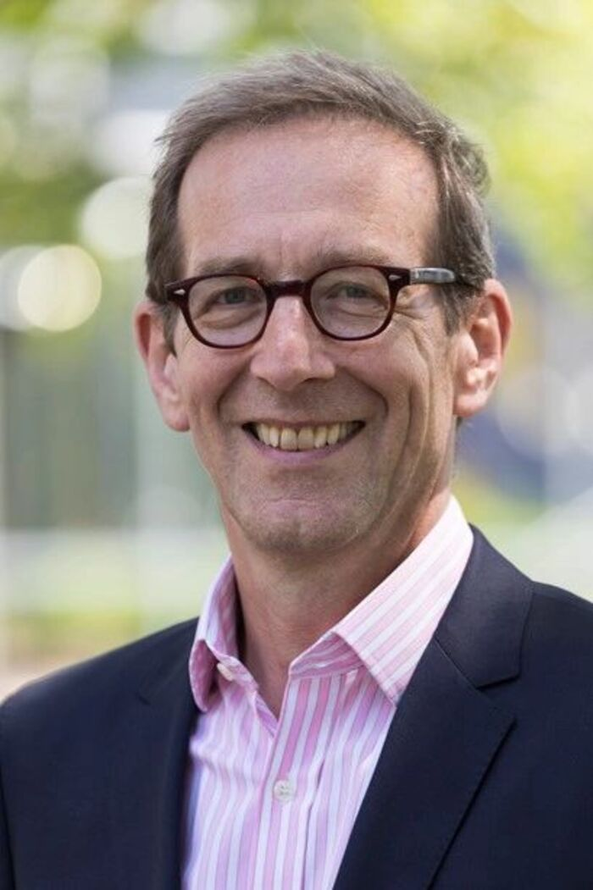

# Dr Michael Salmony

An internationally recognised leader on strategy of business innovations in digital and financial services with a particular focus on Payments, FinTech, Digital and Tokenised Money (Stablecoins, Deposit Tokens, CBDC/Digital Euro), Open Finance and AI in financial services.

<a class="button" href="/contact/">Get in touch</a> <a class="button quiet" href="https://www.linkedin.com/in/salmony/">Connect on LinkedIn</a>

<figure></figure>

He is board-level advisor to major international banks, industry associations, regulators, global consultancies, service providers and investors across the world. He regularly helps shape future directions in key decision-making bodies (e.g. European Commission/European Parliament/ECB/Think-Tanks in Europe, and central banks from Japan to Uruguay and Kazakhstan). For 10 years he served as Executive Adviser to the Board of Worldline Financial Services, helping to bring them from a local player to become the world’s 4th largest financial processor of transactional services, which handles over 17 trillion Euro per year.

He also works with multiple regions where financial innovations are currently emerging - for example with the World Bank in Central Asia, as Advisory Board Member of Fintech Africa, as Advisory Board Member to Mastercard in Latin America, as strategic partner to FinTech Istanbul.

His views are much in demand as keynote [speaker](/lectures/) at international events and he appears on TV/Radio/online [media](/media/) on advances in finance and is quoted extensively (e.g. Financial Times, Harvard Business Manager, New Scientist, The Economist and governments from Ghana to Malaysia). He teaches at the Oxford Business School on “AI in Fintech and Open Banking” and at their Bank Governance Programme on “Tokenised Finance”. He also teaches at further universities such as in Japan, Australia, Turkey, Germany and top industry fora such as the EBA (European Banking Association) Academy.

He has [published](/publications/) much own original work which has been translated into many languages including German, Italian, Dutch, Finnish, Polish, Danish, Turkish, Russian, Chinese and Japanese and is cited in hundreds of publications around the world. He is extensively networked into the new financial services space and hosts the popular “The Payments Trilogue” podcast. He co-edited the handbook “Tokenisation of Money: From Fiat Currencies to Stablecoins”, published by Springer in July 2026.

He is a Freeman of the Worshipful Company of International Bankers, Freeman of the City of London and a Fellow of the Royal Society for Arts, Manufactures and Commerce FRSA.

Previous positions include Director Business Development of leading national central bank (Bank of the Year, Best Innovator Award). Before entering the world of finance, he helped transform companies and business models in many industries as IBM’s Director of Market Development Media and Communications Technologies.

He studied at the University of Cambridge UK and is married, with two millennial children.

[Boards and committees](/boards/) | [Clients and references](/clients/) | [Awards and announcements](/announcements/)

